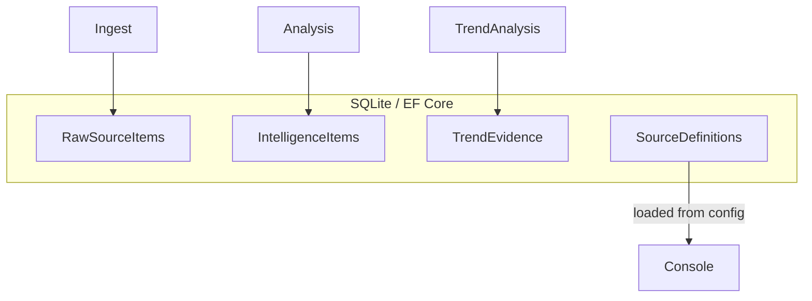

# AI Technology Intelligence POC - High-Level Architecture

This document describes the current implementation in the repository. All statements are grounded in the code; file paths and symbol names are provided so reviewers can verify behavior.

## 1. Solution structure

The solution file is `AiIntelligence.sln` and contains these top-level projects (verify in `AiIntelligence.sln`):

| Project | Responsibility | Important components |
|---|---|---|
| `AiIntelligence.Domain` | Domain models and enums used across the solution. | `RawSourceItem`, `IntelligenceItem`, `TrendEvidence`, `SourceDefinition` (see `src/AiIntelligence.Domain/Models/`). Contains domain enums under `src/AiIntelligence.Domain/Enums/`.
| `AiIntelligence.Application` | Application services: candidate selection, persona generation integration, report composition and rendering. | `ReportOrchestrationService` (`src/AiIntelligence.Application/Reporting/ReportOrchestrationService.cs`), `TrendCandidateSelector` (`src/AiIntelligence.Application/Reporting/TrendCandidateSelector.cs`), `LlmPersonaReportGenerator` (`src/AiIntelligence.Application/Reporting/LlmPersonaReportGenerator.cs`), `MarkdownReportRenderer` (`src/AiIntelligence.Application/Reporting/MarkdownReportRenderer.cs`), `OpenXmlReportDocumentGenerator` (`src/AiIntelligence.Application/Reporting/OpenXmlReportDocumentGenerator.cs`), `XmlSafeTextSanitizer` (`src/AiIntelligence.Application/Reporting/XmlSafeTextSanitizer.cs`). Persistence interfaces are declared under `src/AiIntelligence.Application/Persistence/` (e.g. `IIntelligenceRepository`).
| `AiIntelligence.Infrastructure` | Implementation of persistence, source ingestion, analysis services, and Agent Framework tool adapters. | `AiIntelligenceDbContext` (`src/AiIntelligence.Infrastructure/Persistence/AiIntelligenceDbContext.cs`), repository implementations in `src/AiIntelligence.Infrastructure/Persistence/Repositories/`, Agent Framework orchestration in `src/AiIntelligence.Infrastructure/AgentFramework/` (notably `AIIntelligenceWorkflow`), LLM client adapters in `src/AiIntelligence.Infrastructure/Intelligence/`.
| `AiIntelligence.Console` | Command-line entry point and command dispatch. | `Program.cs` (`src/AiIntelligence.Console/Program.cs`), `ConsoleCommandParser` (`src/AiIntelligence.Console/ConsoleCommandParser.cs`), LLM run-mode helpers (`ConsoleLlmGuard`, `ConsoleLlmModeDecider`).
| Tests | Unit tests for Application/Infrastructure/Domain. | `tests/AiIntelligence.Application.Tests`, `tests/AiIntelligence.Infrastructure.Tests`, `tests/AiIntelligence.Domain.Tests` (look under `tests/`).


> Note: The codebase uses Microsoft Agent Framework types (namespace `Microsoft.Agents.AI.Workflows`) in the `AIIntelligenceWorkflow` orchestration implementation under `src/AiIntelligence.Infrastructure/AgentFramework/AIIntelligenceWorkflow.cs`.


## 2. High-level module diagram

The following Mermaid diagram maps the major modules and logical dependencies as implemented in the code (only components that exist in the repository are shown):

```mermaid
flowchart TD
  A[External Sources]
  B[Source Ingestion Service]
  C[RawSourceItem (DB)]
  D[IntelligenceAnalysisService]
  E[IntelligenceItem (DB)]
  F[TrendAnalysisService]
  G[TrendEvidence (DB)]
  H[TrendCandidateSelector]
  I[TrendCorrelationService]
  J[LlmPersonaReportGenerator]
  K[ReportOrchestrationService]
  L[MarkdownReportRenderer]
  M[OpenXmlReportDocumentGenerator]
  N[AIIntelligenceWorkflow]
  O[Persistence: AiIntelligenceDbContext (SQLite)]

  A --> B
  B --> C
  C --> D
  D --> E
  E --> H
  G --> H
  H --> I
  I --> J
  J --> K
  K --> L
  L --> M
  N -->|orchestrates| B
  N -->|orchestrates| D
  N -->|orchestrates| F
  N -->|orchestrates| I
  N -->|orchestrates| J
  N -->|orchestrates| L
  N -->|orchestrates| M
  O -. persisted data .-> C
  O -. persisted data .-> E
  O -. persisted data .-> G
```

Notes:
- The diagram is deliberately conservative: all nodes map to concrete classes and services in the repository. For example `TrendCandidateSelector` is implemented in `src/AiIntelligence.Application/Reporting/TrendCandidateSelector.cs` and used by `ReportOrchestrationService`.
- Persistence is implemented via EF Core `AiIntelligenceDbContext` (`src/AiIntelligence.Infrastructure/Persistence/AiIntelligenceDbContext.cs`). The development configuration points to a local SQLite file in `src/AiIntelligence.Console/appsettings.Development.json`.


## 3. Workflow / event flow

The deterministic orchestration is implemented by `AIIntelligenceWorkflow` in `src/AiIntelligence.Infrastructure/AgentFramework/AIIntelligenceWorkflow.cs` using `Microsoft.Agents.AI.Workflows` builder. The execution order (edges in the workflow) is explicit:

- Ingestion (ingest sources) —> Current analysis —> Trend analysis —> Correlation —> Persona report —> Render report (Markdown) —> Generate DOCX —> Finalize

The workflow builder additionally inserts conditional transitions to finalize early when a stage fails or when `RunReportGeneration` is disabled. See `AIIntelligenceWorkflow.RunReportAsync(...)` for exact edges and stage naming.

Stage handlers (methods) exist with these names and file locations (inside `AIIntelligenceWorkflow`):

| Stage | Method | File |
|---|---|---|
| Ingestion | `ExecuteIngestionAsync` | `src/AiIntelligence.Infrastructure/AgentFramework/AIIntelligenceWorkflow.cs`
| CurrentIntelligence | `ExecuteCurrentAnalysisAsync` | same
| TrendAnalysis | `ExecuteTrendAnalysisAsync` | same
| Correlation | `ExecuteCorrelationAsync` | same
| PersonaReport | `ExecutePersonaAsync` | same
| RenderReport | `ExecuteRenderAsync` | same (writes `output/ai-intelligence-report.md`)
| GenerateDocx | `ExecuteDocxAsync` | same (calls `IReportDocumentGenerator.GenerateDocxAsync`)

Each stage receives and returns an immutable `WorkflowContextState` (`src/AiIntelligence.Infrastructure/AgentFramework/WorkflowContextState.cs`). Note: diagnostic memory metrics were intentionally removed from persisted workflow state; memory diagnostics are logged only (see comments in `WorkflowContextState`).

For each stage the orchestration records success/failure into the `AIIntelligenceWorkflowResult` returned by `RunReportAsync`.


## 4. Data flow and main entities

Key domain models implemented in `src/AiIntelligence.Domain/Models/` are used across the pipeline. Important entities and how they flow:

- `SourceDefinition` (`SourceDefinition.cs`): configuration describing input sources; loaded from configuration via `SourceDefinitionConfigurationLoader` (`src/AiIntelligence.Infrastructure/Configuration/SourceDefinitionConfigurationLoader.cs`).
- `RawSourceItem` (`RawSourceItem.cs`): fetched raw content (created by ingestion). Persisted via EF (`AiIntelligenceDbContext.RawSourceItems`).
- `IntelligenceItem` (`IntelligenceItem.cs`): structured 'current intelligence' extracted from raw sources by `IntelligenceAnalysisService` and persisted via `IIntelligenceRepository`.
- `TrendEvidence` (`TrendEvidence.cs`): evidence items found through trend research (persisted via `TrendEvidence` DbSet).
- `TrendCorrelation` (`src/AiIntelligence.Application/Reporting/TrendCorrelation.cs`): lightweight correlation object produced by `ITrendCorrelationService` implementations and used by persona/report generation.
- `ReportDocument` (`ReportDocument.cs`): the final in-memory presentation model returned by persona report generation + trend composition and consumed by `MarkdownReportRenderer` and `OpenXmlReportDocumentGenerator`.

Data flows from RawSourceItem -> IntelligenceItem and TrendEvidence, then into candidate selection and correlation, and finally into persona generation and report rendering.


## 5. Deterministic vs LLM responsibilities

The codebase combines deterministic logic with LLM-driven components. The table below lists capabilities and whether they are implemented deterministically in code or rely on the LLM (as implemented in the repository). Where LLM is used, the concrete class or interface is named.

| Capability | Deterministic / LLM / Mixed | Implementation (file/class) |
|---|---|---|
| Source retrieval | Deterministic | `SourceIngestionService` (infrastructure) and configured `SourceDefinition`s (`appsettings.Development.json`) — see `src/AiIntelligence.Infrastructure/Sources` and `Program.cs` logic that calls `FetchAsync` / `IngestAsync`.
| Ingestion (parsing/fetching) | Deterministic | `SourceIngestionService` and `IIngestSourcesTool`/`IngestSourcesTool` (infrastructure code).
| AI relevance analysis | Mixed (LLM-driven scoring + deterministic gating) | `IntelligenceAnalysisService` (deterministic ranking/scoring), uses `ILLMClient` for certain classification/extraction tasks — see `src/AiIntelligence.Infrastructure/Intelligence/HttpJsonLlmClient.cs` and `LlmIntelligenceExtractor`.
| AI concept classification | LLM-driven with deterministic post-processing | `LlmIntelligenceExtractor` and `ILLMClient` usage.
| TrendFamily classification | LLM-driven / heuristic | `LlmTrendEvidenceExtractor` and `TrendEvidence` related logic; `TrendEvidenceDuplicateDetector` applies deterministic deduplication.
| Trend extraction from sources | Mixed | `TrendAnalysisService` calls `LlmTrendEvidenceExtractor` which uses `ILLMClient` to extract trend evidence; later deduplication is deterministic (`TrendEvidenceDuplicateDetector`).
| Duplicate detection / suppression | Deterministic | `TrendEvidenceDuplicateDetector` (`src/AiIntelligence.Application/Intelligence/TrendEvidenceDuplicateDetector.cs`).
| Candidate selection | Deterministic | `TrendCandidateSelector` (`src/AiIntelligence.Application/Reporting/TrendCandidateSelector.cs`) — streaming/projection and deterministic scoring; it depends on repository projection APIs like `StreamCandidatesForCorrelationAsync`.
| Correlation relationship (mapping current dev to trend) | LLM-driven with deterministic validation | Implemented by `LlmTrendCorrelationService` (`src/AiIntelligence.Application/Reporting/LlmTrendCorrelationService.cs`); it uses `ILLMClient` and has validation logic to reject malformed outputs.
| Persona generation | LLM-driven with schema guardrails | `LlmPersonaReportGenerator` uses `ILLMClient` to request persona JSON per role and applies strict JSON parsing + fallbacks; fallback generator `MockPersonaReportGenerator` exists for tests and mock mode.
| Report rendering (Markdown) | Deterministic | `MarkdownReportRenderer` (`src/AiIntelligence.Application/Reporting/MarkdownReportRenderer.cs`).
| DOCX generation (OpenXML) | Deterministic (text sanitizer + deterministic mapping) | `OpenXmlReportDocumentGenerator` (`src/AiIntelligence.Application/Reporting/OpenXmlReportDocumentGenerator.cs`) transforms Markdown into DOCX using `MarkdownReportParser` and `XmlSafeTextSanitizer`.

If a capability cannot be determined strictly from the code, this document states "Not determinable from current implementation." — however the code includes explicit uses of `ILLMClient` to call LLMs in the places listed above.


## 6. Microsoft Agent Framework role (specific to this repo)

The repository uses Microsoft.Agents.AI.Workflows types to implement a deterministic orchestration wrapper in `AIIntelligenceWorkflow` (`src/AiIntelligence.Infrastructure/AgentFramework/AIIntelligenceWorkflow.cs`). In this implementation:

- Orchestration responsibility: The `AIIntelligenceWorkflow` builds a `WorkflowBuilder` containing named executors for each pipeline stage (ingestion, current-analysis, trend-analysis, correlation, persona-report, render-report, generate-docx, finalize). The workflow controls the order and conditional paths (e.g., skip remaining stages if a stage sets CanContinue=false).
- Workflow tools: Each stage calls into concrete service/tool adapters (e.g., `IIngestSourcesTool`, `IAnalyzeCurrentIntelligenceTool`, `IAnalyzeTrendEvidenceTool`, `ICorrelateCurrentDevelopmentTool`, `IGeneratePersonaReportTool`, `IRenderReportTool`) which are registered in DI and implemented in the repository under `src/AiIntelligence.Infrastructure/AgentFramework/Tools/`.
- Business logic: Business logic (candidate selection, persona generation, trend deduplication, etc.) lives in application/infrastructure services called by the workflow — the Agent Framework is used as an orchestration engine and does not contain the domain heuristics itself.
- State persistence: Workflow state is represented by `WorkflowContextState` (immutable record). The code intentionally removed memory diagnostics from that persisted state (they are logged only) — see comments in `WorkflowContextState`. The workflow execution uses in-process execution (`InProcessExecution.Default.RunAsync`) and returns `AIIntelligenceWorkflowResult` summarizing stage results. The framework's run history contains `WorkflowContextState` snapshots while executing; the code avoids embedding large diagnostic payloads in those snapshots.


## 7. Persistence

- The application uses Entity Framework Core. `AiIntelligenceDbContext` (`src/AiIntelligence.Infrastructure/Persistence/AiIntelligenceDbContext.cs`) declares DbSets: `SourceDefinitions`, `RawSourceItems`, `IntelligenceItems`, `TrendEvidence`.
- Configuration: connection string in `src/AiIntelligence.Console/appsettings.Development.json` (`ConnectionStrings:AiIntelligence` points to a local file `src\AiIntelligence.Console\ai-intelligence.db`).
- Repository layer: interfaces in `src/AiIntelligence.Application/Persistence/` and repository implementations under `src/AiIntelligence.Infrastructure/Persistence/Repositories/` (e.g., `TrendEvidenceRepository`, `IntelligenceRepository`, `RawSourceRepository`).
- Persistence boundaries: Application services call repository interfaces; workflow and console entrypoints migrate database using `dbContext.Database.MigrateAsync()` before write operations (see `Program.cs` around commands such as `ingest`, `analyze`, `analyze-trends`, `run-workflow`).

A small persistence diagram (mermaid):




## 8. Where to look for important code paths

- Orchestration: `src/AiIntelligence.Infrastructure/AgentFramework/AIIntelligenceWorkflow.cs`
- Ingestion pipeline and services: `src/AiIntelligence.Infrastructure/Sources` and `src/AiIntelligence.Infrastructure/Intelligence`
- Candidate selection: `src/AiIntelligence.Application/Reporting/TrendCandidateSelector.cs`
- Trend deduplication: `src/AiIntelligence.Application/Intelligence/TrendEvidenceDuplicateDetector.cs`
- Correlation service: `src/AiIntelligence.Application/Reporting/LlmTrendCorrelationService.cs` and `src/AiIntelligence.Application/Reporting/MockTrendCorrelationService.cs`
- Persona generation: `src/AiIntelligence.Application/Reporting/LlmPersonaReportGenerator.cs`
- Markdown rendering: `src/AiIntelligence.Application/Reporting/MarkdownReportRenderer.cs`
- DOCX generation and sanitization: `src/AiIntelligence.Application/Reporting/OpenXmlReportDocumentGenerator.cs` and `src/AiIntelligence.Application/Reporting/XmlSafeTextSanitizer.cs`


## 9. Known constraints and explicit implementation notes

- The LLM client interface is `ILLMClient` implemented by `HttpJsonLlmClient` and `MockLlmClient` (`src/AiIntelligence.Infrastructure/Intelligence`). Calls to real LLMs require configuration under `Foundry` in configuration (see `LlmClientOptions` and `Program.cs` validation). Unit tests use `MockLlmClient` or NSubstitute for `ILLMClient`.
- `OpenXmlReportDocumentGenerator` sanitizes all text for XML 1.0 compliance using `XmlSafeTextSanitizer` before creating `Text` nodes; the sanitizer and caller log removed code points (see `OpenXmlReportDocumentGenerator.SanitizeForOpenXml`).
- The workflow persists `WorkflowContextState` via the Agent Framework run snapshots but intentionally avoids embedding memory diagnostics in the persisted state (they are logged only), see `WorkflowContextState` comments.


## 10. Not determinable from current implementation

- Any runtime telemetry or external API quota/credentials present in the environment are not part of the repository and therefore not determinable here.
- Runtime behavior when connecting to external sources or the LLM in a real environment depends on configuration outside this repository (e.g., Foundry:ApiKey). The code paths exist, but exact runtime outputs are environment-dependent.


End of architecture document.
